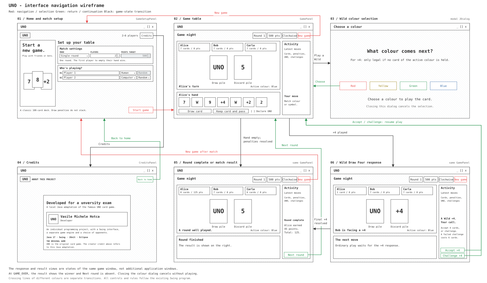

# UNO

A local UNO game written in Java with Swing, for two to six human or computer players. It supports single rounds and points matches, UNO declarations, Wild Draw Four challenges, and four bot strategies: Random, Greedy, Conservative, and Aggressive.

## Wireframe

### How to run the game

You can import the whole project in Eclipse and run main/src/main/java/uno/ui/UnoApplication.java or download the .jar file and run that directly.